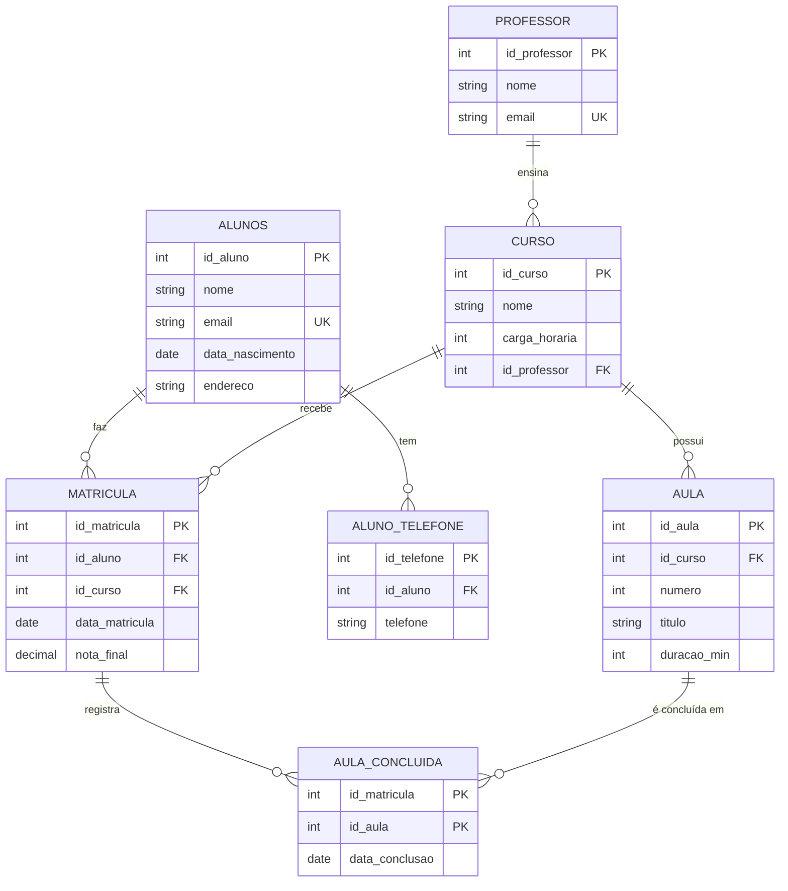

# Modelo normalizado: CursoÁgil

## Legenda

| Sigla | Significado | Papel |
|---|---|---|
| PK | Primary Key (chave primária) | Identifica cada linha de forma única; não repete nem fica vazia |
| FK | Foreign Key (chave estrangeira) | Guarda a PK de outra tabela e cria a ligação entre elas |
| UK | Unique Key (chave única) | Não aceita valores repetidos, mas não é o identificador principal |

## 1. Planilha original

`aluno, email_aluno, telefones, curso, carga_horaria, professor, email_professor, data_matricula, nota_final`

## 2. Normalização

**1FN (valores atômicos):** a coluna `telefones` tinha mais de um valor por célula. Cada telefone passa a ocupar uma linha própria, na tabela `aluno_telefone`.

**2FN (sem dependência parcial da chave):**
- `nome`, `email`, `data_nascimento` e `endereco` dependem só do aluno, então vão para `aluno`.
- `carga_horaria` e `professor` dependem só do curso, então vão para `curso`.
- `data_matricula` e `nota_final` dependem do par aluno + curso, então ficam em `matricula`.

**3FN (sem dependência transitiva):** `curso → professor → email_professor`. Os dados do professor saem de `curso` e vão para `professor`. A tabela `curso` guarda apenas a FK. O endereço fica como um único campo para não criar dependências como `cidade → estado`.

**Itens do enunciado que a planilha não cobre:** as aulas (número, título, duração em minutos) e as aulas concluídas (com a data de conclusão). Por isso surgem `aula` e `aula_concluida`.

## 3. Tabelas finais

### PROFESSOR
| Tipo | Coluna | Marcação |
|---|---|---|
| int | id_professor | PK |
| string | nome | |
| string | email | UK |

### CURSO
| Tipo | Coluna | Marcação |
|---|---|---|
| int | id_curso | PK |
| string | nome | |
| int | carga_horaria | |
| int | id_professor | FK → PROFESSOR(id_professor) |

### AULA
| Tipo | Coluna | Marcação |
|---|---|---|
| int | id_aula | PK |
| int | id_curso | FK → CURSO(id_curso) |
| int | numero | |
| string | titulo | |
| int | duracao_min | |

Restrição: `UNIQUE (id_curso, numero)`

### ALUNOS
| Tipo | Coluna | Marcação |
|---|---|---|
| int | id_aluno | PK |
| string | nome | |
| string | email | UK |
| date | data_nascimento | |
| string | endereco | |

### ALUNO_TELEFONE
| Tipo | Coluna | Marcação |
|---|---|---|
| int | id_telefone | PK |
| int | id_aluno | FK → ALUNOS(id_aluno) |
| string | telefone | |

### MATRICULA
| Tipo | Coluna | Marcação |
|---|---|---|
| int | id_matricula | PK |
| int | id_aluno | FK → ALUNOS(id_aluno) |
| int | id_curso | FK → CURSO(id_curso) |
| date | data_matricula | |
| decimal | nota_final | |

Restrição: `UNIQUE (id_aluno, id_curso)`

### AULA_CONCLUIDA
| Tipo | Coluna | Marcação |
|---|---|---|
| int | id_matricula | PK, FK → MATRICULA(id_matricula) |
| int | id_aula | PK, FK → AULA(id_aula) |
| date | data_conclusao | |

Chave primária composta: `(id_matricula, id_aula)`

## 4. Relacionamentos

| Relação | Cardinalidade | Como é resolvida |
|---|---|---|
| Professor → Curso | 1:N | FK `id_professor` em `curso` |
| Curso → Aula | 1:N | FK `id_curso` em `aula` |
| Aluno → Telefone | 1:N | FK `id_aluno` em `aluno_telefone` |
| Aluno ↔ Curso | N:N | tabela `matricula` |
| Matrícula ↔ Aula | N:N | tabela `aula_concluida` |

## 5. DER (Mermaid)

## 6. Observações

- `aula_concluida` liga a `matricula` (e não direto ao aluno) porque o aluno só conclui aulas de cursos em que está matriculado.
- `carga_horaria` ficou em `curso` por ser tratada no enunciado como atributo do curso. Ela poderia ser derivada da soma das durações das aulas.
- `data_nascimento` e `endereco` são campos extras, não exigidos pelo enunciado.

LINK DO Excalidraw:
https://excalidraw.com/#json=Motk7GoyBTLLTvvzQfiwq,i7mXOSDqbfG8Pj8-8AzjiA
